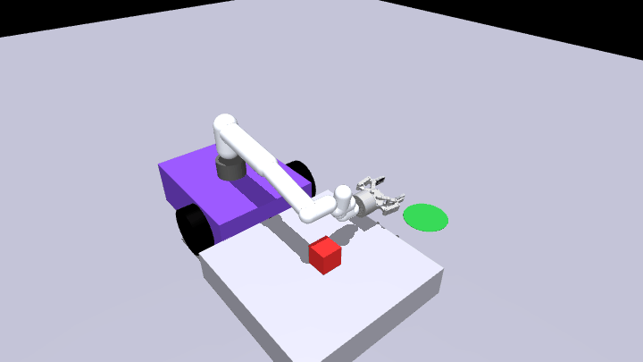
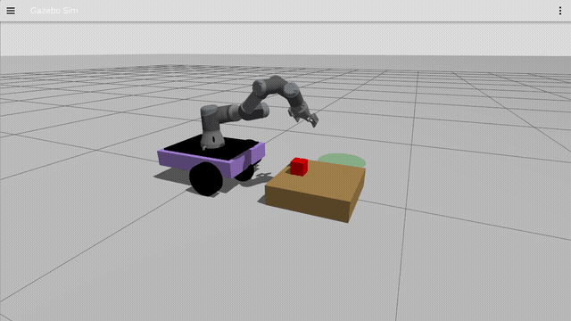

# ARES: Autonomous Robotic End-to-End System — UR3 Mobile Pick & Place via RL

[](https://docs.ros.org/en/humble/)
[](https://gazebosim.org/)
[](https://python.org)
[](https://mujoco.org/)
[](https://github.com/Stable-Baselines-Team/stable-baselines3-contrib)
[](https://opensource.org/licenses/MIT)

> **Platform:** ROS2 Humble · Gazebo Harmonic · MuJoCo · Ubuntu 22.04 · CUDA

A mobile manipulator that learns pick-and-place with **RL + a scripted pre-grasp routine**, plus a classical **whole-body controller (WBC)** that serves as a baseline and as a demonstrator for imitation. A differential-drive base carries a 6-DOF UR3 arm with a Robotiq 2F-85 gripper. **TQC** (Truncated Quantile Critics) learns the manipulation stages from dense reward shaping in Gazebo/ROS2. The same robot runs in MuJoCo for fast WBC rollouts, behaviour cloning, DAgger and residual RL.

<p align="center">
  
  
</p>
<p align="center"><b>MuJoCo</b> &nbsp;·&nbsp; <b>Gazebo</b></p>

**Contents:** [Highlights](#highlights) · [Quick start](#quick-start) · [WBC and imitation](#whole-body-controller-and-imitation) · [Residual RL](#residual-rl-on-the-cloned-policy) · [Gazebo](#gazebo) · [RL system](#rl-system) · [Architecture](#architecture) · [Launch guide](#launch-guide) · [Training](#training)

---

## Highlights

**Learning**
- **No motion planning in the RL loop** — one TQC policy controls 6 arm joints, gripper and base together
- **Phase-based curriculum** — 5 phases, milestone bonuses (+100 to +1000), retreat penalised 3–4× harsher than approach
- **Residual RL on a frozen clone, honestly reported** — a capped, penalised residual on the WBC-cloned actor, resumable and scored on 50 held-out seeds. It did not beat the clone (0.92) in any run, and the README table shows why

**Verification**
- **Ground-truth checks** — Gazebo picks are judged by the real cube pose, not the controller's estimate, which exposed "place complete" logs that never moved the cube
- **Grasp verification** — the object's lift is checked against the real Gazebo pose for up to 80 steps before success is confirmed
- **Real Gazebo poses** — the `ros_gz` dynamic_pose bridge gives ground-truth object position, no fake randomisation

**Engineering**
- **Analytical FK** — UR3 DH parameters give the EE world position with zero TF latency
- **VecNormalize** — online normalisation of all 46 observation dims and the reward, critical for mixed-scale inputs
- **Caster-aware pregrasp** — the front caster (r = 6 cm, x = +30 cm from chassis) stays clear of the bin wall as the arm reaches over it

**Task stages:** pre-grasp (scripted) → approach → grasp → lift to 25 cm → transport (base drives to the drop zone) → place and release.

---

## Quick Start

```bash
git clone https://github.com/darshmenon/pickplace-rl-mobile-manipulator.git
cd pickplace-rl-mobile-manipulator
source /opt/ros/humble/setup.bash
pip install stable-baselines3 sb3-contrib gymnasium tensorboard
colcon build --packages-select pickplace_rl_mobile --symlink-install
source install/setup.bash          # repeat the two source lines in every new terminal
```

Run the best saved policy in Gazebo:

```bash
ros2 launch pickplace_rl_mobile full_system.launch.py \
  use_rl:=true use_perception:=false \
  model_path:=./rl_models/best_model/best_model.zip
```

`use_perception:=false` uses the world-file fallback pose `[0.6, 0.0, 0.1325]`, matching the red box in `pickplace_world.world`. To train or resume, see [Launch guide](#launch-guide).

---

## Whole-Body Controller and Imitation

A classical WBC drives the arm and base together in MuJoCo, and acts as both baseline and demonstrator.

| Component | File | Role |
|-----------|------|------|
| WBC baseline | `wbc_baseline.py` | Damped least-squares over 6 arm joints + base speed and yaw rate (8 velocity variables; the policy's 9-D action adds the gripper), top-down grasp, pinch end-effector |
| Comparison | `compare_wbc_policy.py` | Same seeds and metrics for WBC and trained policies |
| Demo collection | `collect_demos.py` | Parallel WBC rollouts with action noise, successful episodes only |
| BC and DAgger | `bc_finetune.py` | Clone the WBC into a TQC actor, DAgger relabelling, optional TQC fine-tune |

```bash
python3 -m pickplace_rl_mobile.compare_wbc_policy --episodes 8
python3 -m pickplace_rl_mobile.collect_demos --episodes 160 --workers 16
python3 -m pickplace_rl_mobile.bc_finetune --demos demos/wbc_pinch.npz --bc-steps 16000
```

**Results** (MuJoCo, seeds 100–119, episodes run back to back, 400-step limit):

| Controller | Success | Mean steps |
|------------|---------|------------|
| Whole-body controller | 20/20 | 117 |
| Policy cloned from the WBC (BC only) | 19/20 | 133 |

Demos come from 192 noisy episodes (145 succeed, 23k transitions). The MuJoCo env resets to its initial state every episode, which the demos and evaluation depend on.

---

## DAgger on the Clone

One DAgger pass on the clone (3 rounds, 32 rollouts each on fresh seeds, WBC relabelling, BC learning rate 2e-4, `bc_finetune.py --dagger-seed-start --dagger-lr`) removes the lift failures. The clone's failures were almost all at the lift phase (13 of 16 and 14 of 15); the DAgger policy has none, but fails more often at descend.

| Held-out seeds | Clone | DAgger round 2 | Lift failures |
|---|---|---|---|
| 5000 to 5199 | 184/200 | 194/200 | 13 to 0 |
| 6000 to 6199 | 185/200 | 191/200 | 14 to 0 |

Overall success is within noise (sign test p about 0.05 and 0.29), since it breaks seeds the clone solved. Round 2 was picked after scoring two rounds on the first seed set; the second set was not used to choose. Rounds dip and recover (0.97, 0.67, 0.93 on 30 seeds), so every round is saved. Failure tables: `docs/failure_benchmark.md` (clone) and `docs/failure_benchmark_dagger.md`. The weights are in `rl_models/mujoco_dag2/tqc_dagger_2.zip`.

---

## Residual RL on the Cloned Policy

Plain, BC-anchored and uncapped residual online fine-tuning collapsed the policy in every run:

| Fine-tuning run | Eval success |
|-----------------|--------------|
| Plain online TQC | 0.88 to 0.00 within a few thousand steps |
| Residual, scale 0.1, actor accidentally unfrozen | 0.12 at 5k steps, 0.00 after |
| Residual, scale 0.1, actor frozen for 50k steps | 1.00 while frozen, 0.00 within 5k steps of unfreezing |
| Residual, scale 0.02, penalty 5.0, frozen for 30k | 1.00 while frozen, then noisy (0.00 to 1.00) |
| Same, frozen for 60k | 0.87 while frozen, 0.00 right after unfreezing, 0.44 held-out at 100k |
| Same, frozen for 30k, actor lr 1e-5, one actor step per 4 | 0.90 right after unfreezing, then 0.07 to 0.83, 0.48 held-out at 100k |

None of these beat the clone on unseen seeds. On 50 held-out seeds the clone scores 0.92 and the best residual snapshots 0.88 to 0.98. The high scores come from frozen or barely trained actors, so they are seed noise, not learning. The clone stays the best policy and the residual is reported as a negative result.

What the runs show: a longer critic warm-up made the collapse worse, and a slower actor only delayed it. Selecting checkpoints on a few evaluation seeds is misleading, so use at least 50 held-out seeds (`--seed-start`). Ideas not yet tried are a conservative critic and a pull of the residual toward zero.

---

## Gazebo

`wbc_node` (launched with `wbc_pickplace.launch.py`) picks the cube, carries it and releases it at the target. It places the cube flat on the bin top next to the pick spot.

- **Arm-only by default.** The stock wheels give no traction on this 63 kg robot (odometry drifts while the base stays put), so the node reaches with the arm alone (`fixed_base`) and the launch moves the cube to x = 0.5, inside arm reach.
- **`drive:=true` drives up to the cube first, then picks.** Traction and grasping conflict under Featherstone: 0.5 kg wheels grasp but cannot drive, 15 kg wheels drive but the grasp fails, and wheel friction of 300 does not help. So the base is pushed by Gazebo's velocity-control plugin (`mobile_ur3_vel.urdf`) and stops within 2 mm of the pick spot, checked against the real base and cube poses. Details: [docs/gazebo_drive_traction.md](docs/gazebo_drive_traction.md).
- **Recording.** A scene-only view is in `config/gui_clean.config` (`gz sim -g --gui-config`), and a side camera for verification is bridged as `/verify_cam`.

---

## RL System

### Algorithm: TQC (Truncated Quantile Critics)

Upgraded from SAC (best reward −328). TQC spreads the return estimate over several quantile networks and drops the top quantiles before Bellman updates, which suppresses Q-value overestimation and stabilises grasping.

| Hyperparameter | Value | Why |
|---------------|-------|-----|
| Policy network | `[512, 512, 512]` | Deeper than the default for the 46-dim → 9-dim mapping |
| `gradient_steps` | 4 | Higher sample efficiency |
| `buffer_size` | 500,000 | Off-policy replay buffer |
| `batch_size` | 512 | Stable gradients |
| `gamma` | 0.99 | Long-horizon discounting for the multi-phase task |
| `learning_starts` | 1,000 | Random exploration before the first update |
| `VecNormalize` | `clip_obs=10` | Online obs normalisation; the eval env uses frozen stats |
| `top_quantiles_to_drop` | 2 | Conservative Q-targets |

### Observation Space — 46 dimensions

| Field | Dim | Notes |
|-------|-----|-------|
| `joint_positions` | 6 | UR3 arm angles (rad) |
| `joint_velocities` | 6 | UR3 arm speeds (rad/s) |
| `finger_position` | 1 | 0 = open, ~0.8 = fully closed |
| `ee_pos` | 3 | EE XYZ in **world frame** via DH FK |
| `obj_pos` | 3 | Object XYZ from the Gazebo dynamic_pose bridge |
| `ee_to_obj` | 3 | Tracking vector from EE to object |
| `ee_to_target` | 3 | Vector from EE to placement target |
| `obj_to_target` | 3 | Vector from object to placement target |
| `obj_in_base` | 3 | Object position in the base frame |
| `gripper_error` | 1 | Error to the desired open/closed state |
| `object_grasped` | 1 | Binary, set by grasp verification |
| `current_phase` | 1 | Integer phase (1–5) |
| `base_pose` | 3 | Base x, y, heading θ from odometry |
| `prev_action` | 9 | Previous action, for temporal context |

All quantities share the **world frame**, so there are no mixed-frame distance bugs.

### Action Space — 9 dimensions (continuous, clipped to [−1, 1])

| Field | Dim | Notes |
|-------|-----|-------|
| `joint_deltas` | 6 | Position delta per arm joint, max ±0.25 rad/step, P-controlled to velocity |
| `gripper` | 1 | >0 closes at 0.5 rad/s, <0 opens |
| `base_linear` | 1 | Forward speed (×0.5 m/s), **zeroed in phases 1–3** |
| `base_angular` | 1 | Turn speed (×1.0 rad/s), **zeroed in phases 1–3** |

Position-delta control (not raw velocity) gives a stable zero-action baseline: the arm holds still when the policy outputs 0.

### 5-Phase Curriculum

| Phase | Goal | Reward signal | Transition |
|-------|------|---------------|------------|
| **1** | Lower EE to grasp height and close XY to the object | `Δdist × 100` approach / `× 300` retreat | `dist_z < 4 cm AND dist_xy < 6 cm` |
| **2** | Reach the object and close the gripper | `Δdist × 80 / × 320` + proximity/touch bonuses | Gripper > 0.7 AND dist < 4 cm |
| **3** | Lift the object to 25 cm | `Δheight × 100 / × 200` | EE height within 5 cm of 25 cm |
| **4** | Transport to the drop zone | `Δdist × 50` base + arm | EE within 15 cm of target XY |
| **5** | Lower and release | `Δdist × 50` | EE within 8 cm, gripper open |

**Milestone bonuses:** +100 (phases 1, 3, 4, 5), +1000 (grasp success at phase 2).

`CurriculumCallback` in `train_rl.py` drives stage transitions from `config/curriculum.yaml`. The default advances or reverts on fixed eval-reward thresholds. `--adaptive-curriculum` advances once eval reward plateaus (rolling improvement below `epsilon` over `window` evals), gated by a `floor_ratio` safety floor.

The per-step reward is potential-based shaping plus proximity/alignment bonuses and safety terminations (out-of-bounds, EE underground, runaway joint velocity). Full breakdown: **[CONCEPTS.md §4](./CONCEPTS.md#4-potential-based-reward-shaping)**, with constants in `pickplace_env.py::compute_reward()`.

### Hyperparameter Tuning

Per-algorithm hyperparameters live in `config/algo_hparams.yaml`, loaded by `agent_factory.hparams_for()`. Edit it to sweep values without touching `train_rl.py`; missing keys fall back to `agent_factory._DEFAULT_HPARAMS`. For automated search, `optimize_rl.py` runs an Optuna study with a median pruner:

```bash
ros2 run pickplace_rl_mobile optimize_rl --n-trials 20 --timesteps-per-trial 30000 \
  --algo tqc --curriculum-stage 1 --storage sqlite:///rl_models/optuna/study.db
```

A short trial can't reach the full 5-phase task, so treat the winning config (`rl_models/optuna/<study-name>_best_hparams.yaml`) as a starting point and verify it with a full `train_rl.py` run. `--storage` makes the study resumable.

---

## Architecture

```
Episode reset()
    ├── Randomise object XY ±4 cm (domain randomisation)
    ├── Scripted pre-grasp (P-controller, up to 300 steps):
    │       · Turn base to face the object
    │       · Drive forward only while chassis_x ≤ 0.16 m
    │         (keeps the 6 cm front caster clear of the bin back wall at x≈0.40 m)
    │       · Extend arm: pan=0, shoulder=-1.7, elbow=2.0, wrist_1=-1.0
    │       · Break when EE is within 30 cm XY of the object
    └── Hand off to RL at phase 1

RL step()  (~40 Hz)
    ├── Spin ROS node (joint_states, odom, dynamic_pose)
    ├── Compute DH FK → EE world position
    ├── Execute action (position-delta arm + gripper + base)
    ├── Compute phase reward + check transitions
    └── Return (obs, reward, terminated, truncated)
```

**FK pipeline:** UR3 DH parameters give the EE analytically. A 180° yaw on `base_link_inertia` flips the FK output (x→−x, y→−y) before the arm mount offset is added, giving the EE in the chassis frame, then the world frame via odometry.

---

## Launch Guide

### RL training

```bash
bash src/pickplace_rl_mobile/launch/run_rl_training.sh --resume-best --headless
```

| Flag | Effect |
|------|--------|
| `--resume-best` / `--resume-latest` / `--fresh` / `<checkpoint.zip>` | Which weights to start from |
| `--headless` | No Gazebo GUI (omit if `DISPLAY` works and you want to watch) |
| `--curriculum-stage N --timesteps N` | Train a specific curriculum stage |
| `--fast` | Sparser eval/checkpoint, 1 gradient step, for quick iteration |

Flags combine freely, e.g. `--resume-best --fast --headless`. Full list: `run_rl_training.sh --help`.

### Gazebo only

```bash
ros2 launch pickplace_rl_mobile gazebo.launch.py                    # with GUI
ros2 launch pickplace_rl_mobile gazebo.launch.py headless:=true     # headless

# Warehouse-dressed world for demos and screenshots (same task objects and poses, slower to load, not for training)
ros2 launch pickplace_rl_mobile gazebo.launch.py world:=pickplace_world_warehouse.world
```

The warehouse world places the same `object_bin`, `target_zone`, `pickup_object` and camera inside a warehouse shell (AWS RoboMaker Small Warehouse models, vendored under `src/ur_gazebo/models/aws_robomaker_warehouse_*`). Training keeps the minimal `pickplace_world.world`: fewer meshes mean faster resets, and rewards and observations don't depend on scenery.

### Whole-body controller in Gazebo

```bash
ros2 launch pickplace_rl_mobile wbc_pickplace.launch.py                    # arm-only pick
ros2 launch pickplace_rl_mobile wbc_pickplace.launch.py drive:=true        # drive up to the cube, then pick
```

### Trainer only

Use this only if Gazebo is already running in another terminal.

```bash
ros2 launch pickplace_rl_mobile rl_train.launch.py
ros2 launch pickplace_rl_mobile rl_train.launch.py load_model:=./rl_models/best_model/best_model.zip   # resume
```

### Full system and VLA pipeline

```bash
ros2 launch pickplace_rl_mobile full_system.launch.py                       # broader inference/demo stack
ros2 launch pickplace_rl_mobile full_system.launch.py use_rl:=true use_perception:=false \
  model_path:=./rl_models/best_model/best_model.zip                         # with RL inference
ros2 launch pickplace_rl_mobile full_system.launch.py use_nav2:=true        # with Nav2

ros2 launch pickplace_rl_mobile vla_full_pipeline.launch.py                 # VLA pipeline
ros2 launch pickplace_rl_mobile vla_full_pipeline.launch.py use_llm:=false use_owlv2:=false   # lighter fallback
```

### RViz and URDF view

```bash
ros2 launch pickplace_rl_mobile display_launch.py
```

---

## Training

```bash
tensorboard --logdir ./rl_models/tensorboard        # open http://localhost:6006

ros2 topic echo /joint_states --once                # check live state
ros2 topic echo /odom --once
ros2 topic hz /arm_controller/joint_trajectory --window 5   # is the policy publishing arm commands?

pkill -f "gz sim|ros2 launch|parameter_bridge|train_rl"     # stop Gazebo/ROS if needed
```

- **Files.** Checkpoints save every 10k steps to `./rl_models/`. The best eval checkpoint is `./rl_models/best_model/best_model.zip` with stats in `best_vecnormalize.pkl`. Latest-run stats go to `./rl_models/vecnormalize.pkl` and replay data to `./rl_models/replay_buffer.pkl`; both are reused automatically on resume when compatible. Eval progress is in `./rl_models/evaluations.npz` (plot with `python3 plot_training.py`).
- **Trainer behaviour.** It auto-detects legacy 27-dim vs current 46-dim observations, restores VecNormalize and replay-buffer state on resume, and anneals the scripted approach/transport assist to zero over training (eval always runs with assist off, so best-model selection reflects the learned policy alone). `--policy-arch transformer` swaps the MLP head for a self-attention encoder over named observation groups; it needs a fresh model.
- **Concurrent runs** (e.g. `--policy-arch mlp` vs `transformer`) can share the machine if each gets disjoint `PICKPLACE_DOMAIN_BASE`, `PICKPLACE_TRAIN_PARTITION`, `PICKPLACE_EVAL_PARTITION`, `PICKPLACE_RUNTIME_ROOT` and its own `--save-dir`.

---

## Concepts

See **[CONCEPTS.md](./CONCEPTS.md)** for deep-dives on TQC, phase curriculum, potential-based reward shaping, hierarchical control, position-delta control, DH forward kinematics, grasp verification, domain randomisation, VecNormalize and the replay buffer.

---

## Maintainer

**Darsh Menon** — [darshmenon02@gmail.com](mailto:darshmenon02@gmail.com) · GitHub: [@darshmenon](https://github.com/darshmenon)
